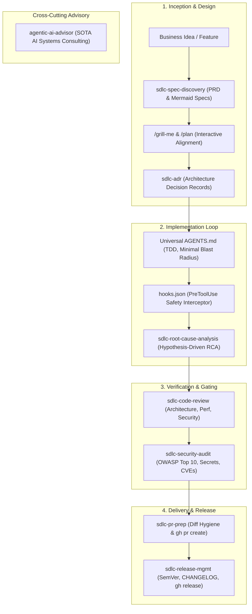

# Enterprise SDLC Suite for Google Antigravity (`antigravity-sdlc-pack`)

A standardized, production-grade customization pack for [Google Antigravity](https://antigravity.google) that covers the end-to-end Software Development Life Cycle (SDLC) following state-of-the-art agentic engineering best practices.

---

## 🏛 Architecture & Capabilities

This pack packages deterministic safety hooks, universal software engineering rules, and on-demand procedural skills:



---

## 📦 What's Included

### 1. Universal Engineering Rules (`rules/AGENTS.md`)
- **TDD Enforcement**: Business logic changes require tests. Zero assertion deletions.
- **Surgical Changes**: Minimal blast radius; never reformats untouched code.
- **Git & GitHub Discipline**: Conventional Commits format, `gh` CLI workflows.
- **Hygiene & Safety**: Zero hardcoded secrets, `.gitignore` compliance.
- **Persona Baseline**: Senior Staff Engineer & Google Antigravity / Agentic Systems Architect.

### 2. Runtime Safety Gate (`hooks.json`)
- Intercepts every `run_command` tool call via `PreToolUse`.
- Deterministically blocks destructive commands (`rm -rf /`, `rm -rf ~`, fork bombs, force pushes to `main`/`master`) before execution.

### 3. Progressive SDLC Skills (`skills/`)
All skills use progressive disclosure (0 token overhead until invoked):

| Skill | Trigger Examples | What It Does |
| :--- | :--- | :--- |
| `sdlc-spec-discovery` | *"I have an idea for..."* / *"Design this feature..."* | Generates PRD artifact, BDD Gherkin acceptance criteria, and Mermaid domain models. |
| `sdlc-adr` | *"Create an ADR for choosing X"* / *"Document this decision"* | Standardized Nygard ADR (`docs/adr/NNNN-*.md`) preserving decision drivers and trade-offs. |
| `sdlc-root-cause-analysis` | *"Debug this failure"* / *"Why is this test flaky?"* | Formulates minimal reproduction, tests multiple hypotheses, and applies surgical fixes. |
| `sdlc-code-review` | *"Review my branch"* / *"Audit this PR"* | Pre-merge inspection across Architecture, Reliability, Security, and Performance. |
| `sdlc-security-audit` | *"Run a security audit"* / *"Check for CVEs and secret leaks"* | OWASP Top 10 code audit, dependency vulnerability scanning, and secret leak detection. |
| `sdlc-pr-prep` | *"Prepare a PR for this"* | Self-reviews diffs, runs native project test runners, pushes branch, and opens PR via `gh`. |
| `sdlc-release-mgmt` | *"Cut a release"* / *"Prepare release notes"* | SemVer 2.0 bump, `CHANGELOG.md` generation, Git annotated tag, and `gh release create`. |
| `agentic-ai-advisor` | *"How should I architect this MCP server?"* / *"Explain Antigravity hooks"* | SOTA agentic engineering advice grounded in official Google documentation. |

---

## 🚀 Installation & Usage

### Option 1: Global Installation (Recommended)
Clone this repository directly into your Antigravity global plugins directory:

```bash
git clone https://github.com/enielrodriguez/antigravity-sdlc-pack.git ~/.gemini/config/plugins/antigravity-sdlc-pack
```

Antigravity automatically discovers and activates all rules, hooks, and skills across all your projects.

### Option 2: Project-Scoped Installation
To bind this suite to a specific repository for team-wide sharing:

```bash
git clone https://github.com/enielrodriguez/antigravity-sdlc-pack.git <repo-root>/.agents/plugins/antigravity-sdlc-pack
```

---

## 🛠 Updating

To pull the latest updates to rules and skills:

```bash
cd ~/.gemini/config/plugins/antigravity-sdlc-pack
git pull origin main
```

---

## 📄 License

Apache 2.0
